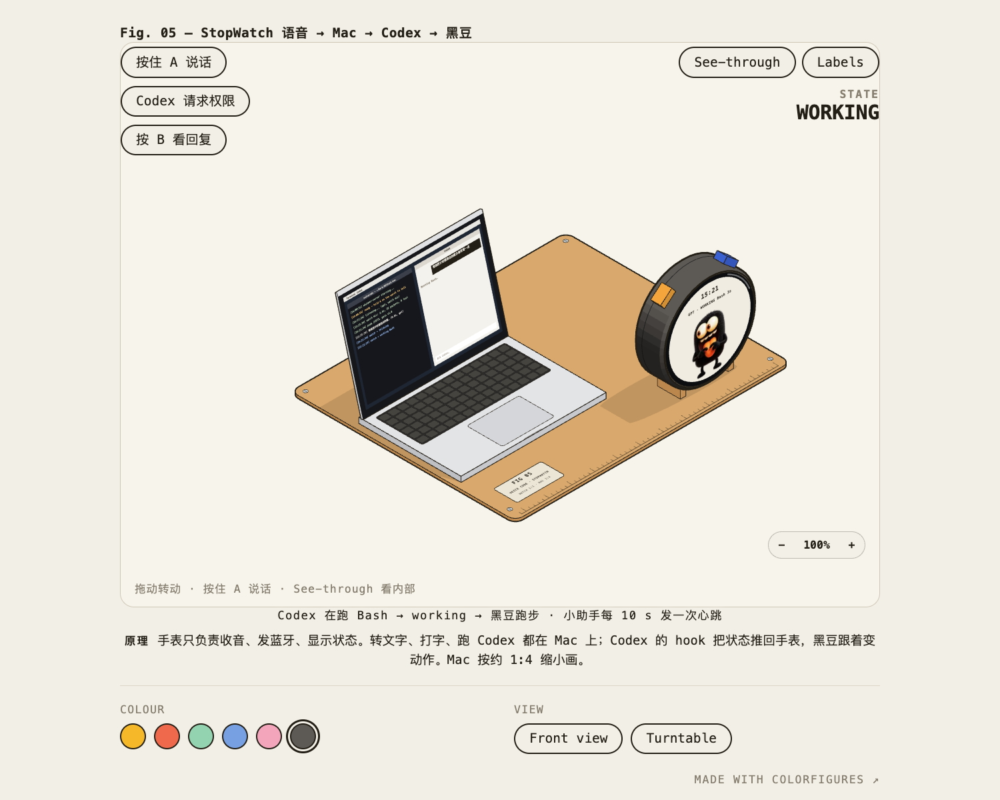
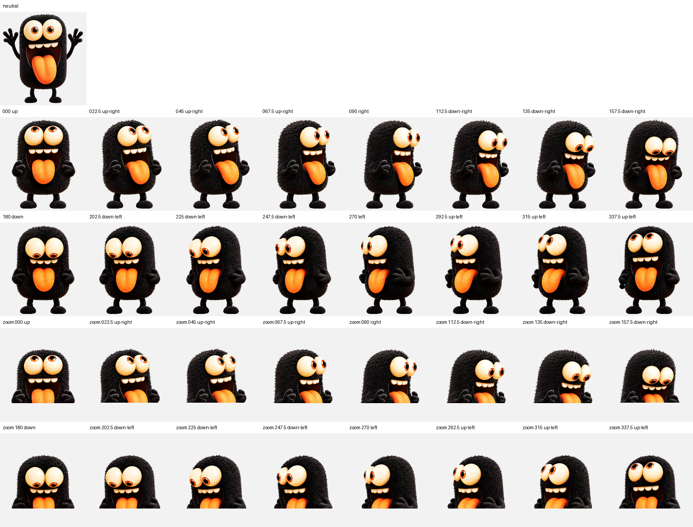

# 黑豆 (heidou)

黑豆是一只热情、调皮的黑色毛茸茸小怪兽。它是一个 Codex pet，也住在 M5StopWatch 手表上：你对手表说话，Codex 在 Mac 上干活，黑豆在表盘上跟着变动作。

本仓库保存黑豆的 Codex pet 包、贴图、手表固件、Mac 端小助手、烧录工具和技术架构。

**交互演示**：https://vigorc.github.io/heidou-stopwatch-demo/



| 待机 `idle` | 挥手 `waving` | 跳跃 `jumping` | 失败 `failed` |
|:--:|:--:|:--:|:--:|
|  |  |  |  |

## 文档

| 文档 | 内容 |
|---|---|
| [docs/architecture.md](docs/architecture.md) | Codex pet：图集布局、制作流程、Codex 加载方式、QA 结果 |
| [docs/stopwatch.md](docs/stopwatch.md) | 手表：帧图转换、固件结构、状态与动画的对应、编译烧录、Mac 端 |

## 安装到 Codex

需要 Python 3 和 Pillow（只用于安装前校验）。

```bash
git clone https://github.com/vigorc/stopwatch_aiagent.git
cd stopwatch_aiagent
scripts/install.sh
```

脚本先校验 pet 包，再复制 `pet.json` 和 `spritesheet.webp` 到 `${CODEX_HOME:-$HOME/.codex}/pets/heidou/`。安装后重启 Codex。

## 烧录到手表

完整步骤见 [docs/stopwatch.md](docs/stopwatch.md#4-编译与烧录)。简要流程：

```bash
cd firmware && source ~/esp/esp-idf/export.sh
idf.py build && idf.py -p /dev/cu.usbmodem1101 -b 921600 app-flash   # 应用
# 再把 fs/（字库 + 黑豆帧图）打包成 storage.bin，写到 0xa00000
```

## 目录

| 路径 | 内容 |
|---|---|
| [pet/heidou/](pet/heidou) | Codex pet 包，和 `~/.codex/pets/heidou` 一致 |
| [pet/heidou-repaired/](pet/heidou-repaired) | 修复了跑步动作的图集，手表用这一版 |
| [assets/](assets) | 原始参考图、基础图、图集总览、视线方向总览、动作 GIF |
| [firmware/](firmware) | 手表固件（基于 M5StopWatch-UserDemo，ESP-IDF）和黑豆帧图 `fs/pets/heidou` |
| [mac/](mac) | Mac 端小助手和 hook 的源码 |
| [tools/](tools) | 帧图转换、串口日志、模拟器服务 |
| [scripts/](scripts) | Codex pet 的安装、校验、切帧脚本 |
| [demo/](demo) | 交互演示页 `stopwatch-pet.html`、源文件、截图 |
| [qa/](qa)、[build/](build) | 制作时的质量检查报告和参数 |

## 脚本

```bash
python3 scripts/validate_pet.py               # 校验 pet 包是否符合 v2 规格
python3 scripts/slice_spritesheet.py [目录]     # 切成 74 张单帧透明 PNG
scripts/install.sh [目标目录]                  # 校验并安装到 Codex
python tools/make_pet_frames.py <pet 目录> <输出目录> 0.8 --lz4   # 生成手表帧图
```

## 视线方向

黑豆有 16 个视线方向，每 22.5° 一个，顺时针排列。`000` 表示朝上。



## 来源

- 黑豆在 2026-09-25 用 Codex 的 hatch-pet 流程制作。参考图由作者提供。
- `firmware/` 基于 [m5stack/M5StopWatch-UserDemo](https://github.com/m5stack/M5StopWatch-UserDemo)，MIT 许可，见 [firmware/LICENSE](firmware/LICENSE)。
