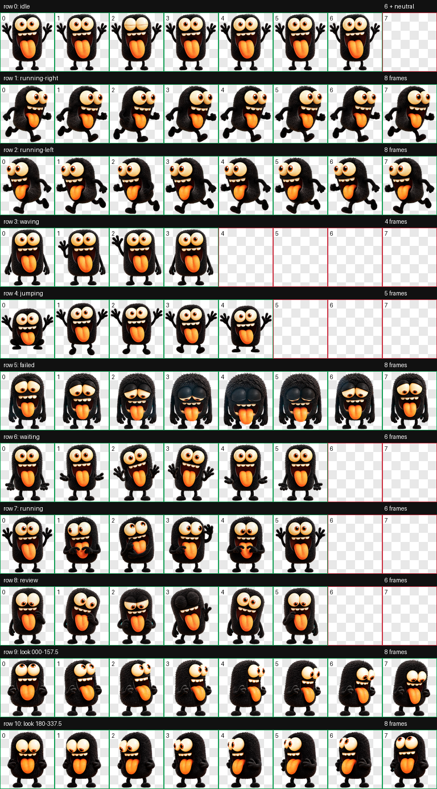

# 黑豆 (heidou)

黑豆是一只热情、调皮的黑色毛茸茸小怪兽。本仓库保存它的 Codex pet 包、贴图、制作记录和技术架构。



| 待机 `idle` | 挥手 `waving` | 跳跃 `jumping` | 失败 `failed` |
|:--:|:--:|:--:|:--:|
|  |  |  |  |

## 安装到 Codex

需要 Python 3 和 Pillow（只用于安装前校验）。

```bash
git clone <本仓库地址>
cd stopwatch_aiagent
scripts/install.sh
```

脚本先校验 pet 包，再复制 `pet.json` 和 `spritesheet.webp` 到 `${CODEX_HOME:-$HOME/.codex}/pets/heidou/`。安装后重启 Codex。

手动安装：把 [pet/heidou/](pet/heidou) 里的两个文件复制到上面的目录。

## 目录

| 路径 | 内容 |
|---|---|
| [pet/heidou/](pet/heidou) | 可安装的 pet 包（`pet.json` + `spritesheet.webp`，1536×2288，8×11 格） |
| [assets/reference/](assets/reference) | 原始参考图、基础图 |
| [assets/preview/](assets/preview) | 图集总览、16 个视线方向总览、9 个动作 GIF |
| [build/pet_request.json](build/pet_request.json) | 制作参数 |
| [qa/](qa) | 质量检查报告 |
| [docs/architecture.md](docs/architecture.md) | **技术架构**：图集布局、制作流程、加载方式、QA 结果 |
| [scripts/](scripts) | 安装、校验、切帧脚本 |

## 脚本

```bash
python3 scripts/validate_pet.py            # 校验 pet 包是否符合 v2 规格
python3 scripts/slice_spritesheet.py [目录]  # 切成 74 张单帧透明 PNG，默认输出到 assets/frames/
scripts/install.sh [目标目录]               # 校验并安装
```

## 视线方向

黑豆有 16 个视线方向，每 22.5° 一个，顺时针排列。`000` 表示朝上。


## 更多

- 技术细节见 [docs/architecture.md](docs/architecture.md)。
- 黑豆在 2026-09-25 用 Codex 的 hatch-pet 流程制作。参考图由作者提供。
